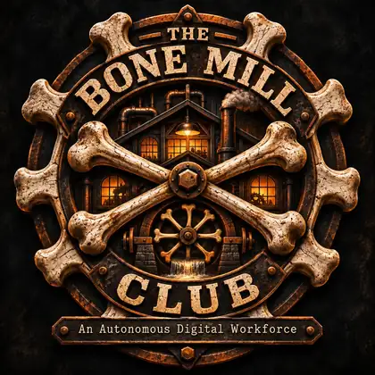

  

# The Bone Mill Club

**An Autonomous Digital Workforce**

I'm building a personal fleet of cloud-based AI agents. Each agent will have its own identity, responsibilities, and permissions. Some will work independently; others will collaborate. I want to reach them securely from anywhere without paying for idle infrastructure.

This is my open-source hobby project. I'm starting small and will build only what I can test and maintain.

## Priorities

- **Security:** Isolate identities, permissions, and private data.
- **Cost:** Set budgets and avoid unnecessary infrastructure.
- **Portability:** Keep agents independent of any one cloud, model, or coding harness.
- **Control:** Give agents scoped autonomy and keep their work observable.

## Status

Foundation stage. This repository contains the [constitution](CONSTITUTION.md), [Apache 2.0 license](LICENSE), and basic GitHub PR/CI safeguards. **No agents or cloud services are deployed yet.** Hosting and runtime choices remain open.
