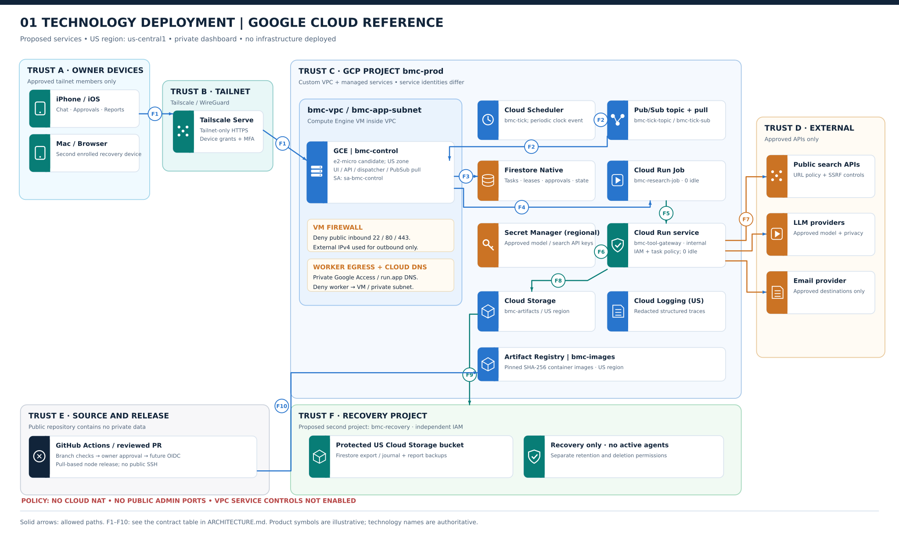
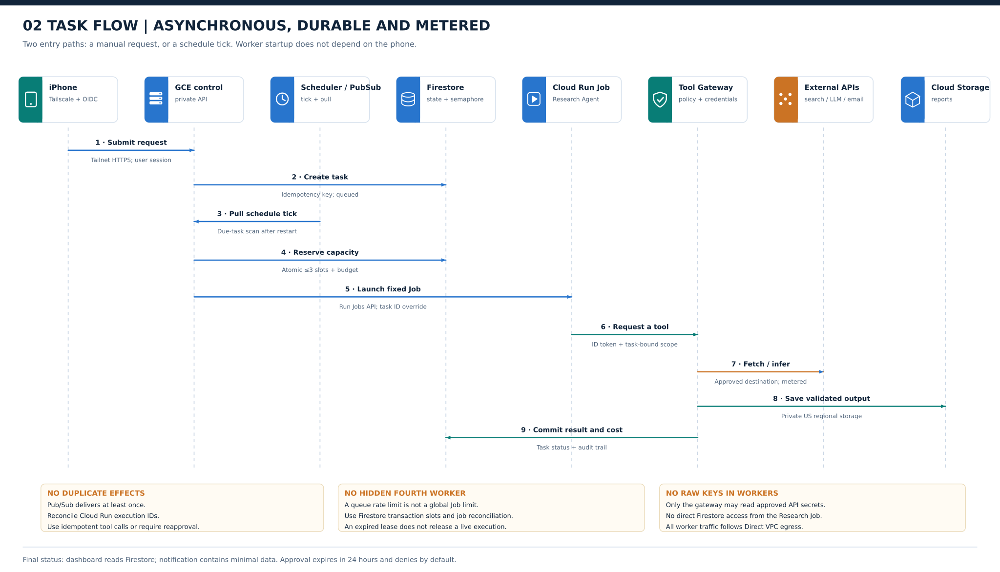
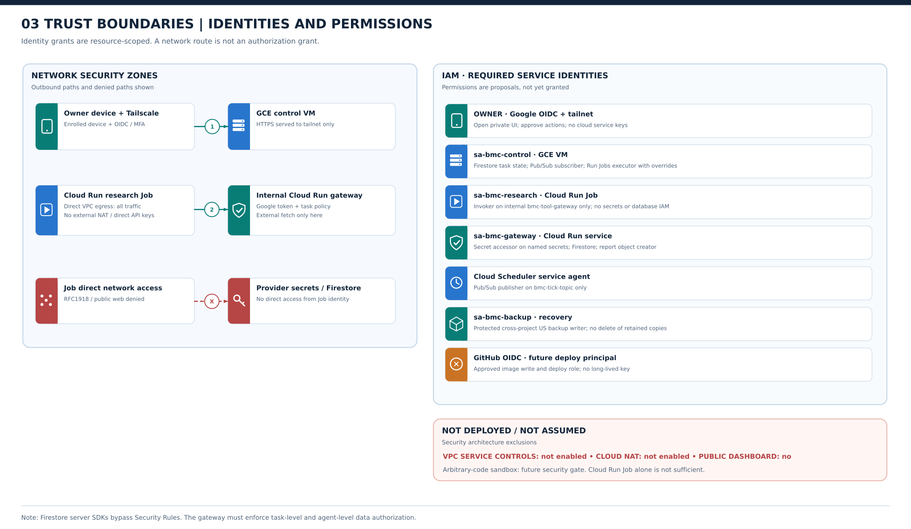
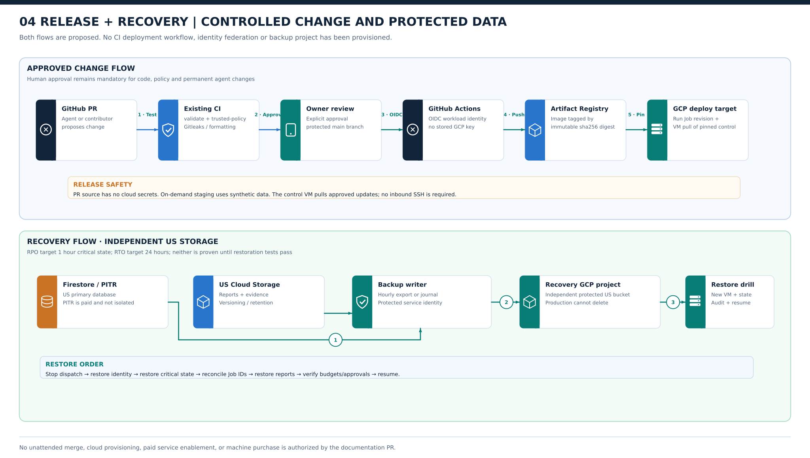

# The Bone Mill Club | Remote-first reference architecture

**Status:** Architecture proposal, reviewed 2026-11-08. **No deployment approval.**
**Reference provider:** Google Cloud (`us-central1`). **Provider choice is not final.**
**Authority:** [Constitution](../CONSTITUTION.md). **First release:** one AI and data engineering Research Agent.
**Writing:** Short, controlled technical English using ASD-STE100 principles. This document is not formally STE-certified.

> **Read the diagrams first.** Names identify proposed services. No project, API, network, identity, or workload shown here exists yet.

| View | Question it answers |
| --- | --- |
|  | Where are the services? Which boundaries and network paths exist? |
|  | How does work move from the phone to a worker and back? |
|  | Who can access each service? What is denied? |
|  | How do approved changes and recovery work? |

## 1. Architecture decision

**Reference design:** A private **Tailscale** entry point on a small **Compute Engine** VM; **Firestore** for durable state; **Cloud Scheduler + Pub/Sub pull** for timing; **Cloud Run Jobs** for research execution; an internal, authenticated **Cloud Run tool gateway** for outbound search, model, and notification calls; **Cloud Storage** for reports and protected recovery copies.

**Reason:** Keep the dashboard reachable when the Mac is off. Block direct public access to the dashboard. Stop workers when idle. Keep secrets and policy enforcement outside agent processes. Reuse managed services where their price is low.

**Not selected:** A cloud provider, a production region, a mobile client, or a final monthly budget. `us-central1` and the service names below are **reference values** for engineering review. The provider decision requires a priced proof of concept.

### Requirements trace

| Decision group | Required result | Design control |
| --- | --- | --- |
| 16–19, 25, 27 | Mobile chat + dashboard worldwide; home Mac optional; approved devices; US-stored data | Private tailnet; owner login; US-region data stores |
| 20–22, 42–43, 49–50 | 2–3 concurrent jobs; durable tasks; 15–60 s cold starts; low idle cost; prioritized queue | Firestore transaction leases; Cloud Run Jobs; on-demand work; recovery window |
| 26, 28–35 | Approved LLMs; per-agent policy; gated external effects; isolated execution; restricted web access; expiring approvals | No worker provider keys; internal gateway; approval ledger; no arbitrary code in v1 |
| 36–41, 58 | Tiered retention; 24 h restore; 1 h critical RPO; release gates; structured traces | US logs; PITR + independent backups; signed/pinned releases; validation checks |
| 44–48, 51–57, 59–61 | Portable agents; GitHub definitions; event hooks later; emergency stop; owned outputs; quality gates; first Research Agent | Versioned configuration; conditional event ingress; fail-closed controls; artifacts in Cloud Storage |

## 2. Concrete GCP deployment map

| Proposed name | Google Cloud product | Location / exposure | Role |
| --- | --- | --- | --- |
| `bmc-prod` | Dedicated GCP project | US workloads; separate IAM/billing alerts | Resource and billing boundary |
| `bmc-vpc` / `bmc-app-subnet` | Custom VPC / subnet | `us-central1`; Private Google Access on | VM network and worker Direct VPC egress; deny worker-to-VM and other private subnet egress |
| `bmc-private-dns` | Cloud DNS private zones | US VPC scope; private VIP records for `run.app` and Google APIs | Keep worker-to-gateway calls on Google private access path |
| `bmc-control` | Compute Engine `e2-micro` VM (candidate) | Private app listener; outbound public IPv4 for Tailscale; **no inbound public firewall rules** | Mobile UI/API; task admission; scheduler subscriber; lease reconciliation |
| `bmc-research-job` | Cloud Run **Job** | `us-central1`; minimum zero instances; one job task per task execution | Trusted, immutable Research Agent code only |
| `bmc-tool-gateway` | Cloud Run **service** | `us-central1`; **internal ingress**; IAM required; scale to zero | Policy, spending, permitted source fetch, model and notification adapters |
| `bmc-tick` / `bmc-tick-topic` / `bmc-tick-sub` | Cloud Scheduler / Pub/Sub topic + pull subscription | US location where supported; no public push endpoint | Trigger due-work scans; durable, at-least-once delivery |
| `(default)` in `bmc-prod` | Firestore Native mode | Single US regional database | Task state, leases, approvals, memory, audit, budgets |
| `bmc-artifacts` | Cloud Storage | US regional bucket, private | Reports, evidence, downloads, versioned outputs |
| `bmc-provider-keys` | **Regional** Secret Manager | `us-central1` | Approved API keys; access only by gateway identity |
| `bmc-logs` | Cloud Logging regional bucket | US region; 30-day diagnostics | Redacted traces, events, resource health |
| `bmc-images` | Artifact Registry | US regional Docker repository | Immutable worker/control images by digest |
| `bmc-recovery` | **Separate recovery project** (proposed) | US storage; separate IAM | Protected recovery objects and export history; no active compute |

**Network path (normal request):** approved device → Tailscale WireGuard overlay → HTTPS via **Tailscale Serve** → localhost control app on `bmc-control`. There is **no** public dashboard IP:443 endpoint. The VM can have a billed public IPv4 **for outbound connections**. The cloud firewall still denies inbound `22`, `80`, `443` and application ports. The Tailscale overlay does **not** make the whole VPC reachable.

**Network path (worker):** `bmc-research-job` → **Direct VPC egress: all traffic** → `bmc-app-subnet` → Private Google Access + **Cloud DNS private zones** for `*.run.app` and Google APIs → internal `bmc-tool-gateway` with Google ID token. Add **worker network-tag egress deny rules** for private subnet ranges. **Do not provision Cloud NAT for workers.** Without outbound NAT, direct external requests from jobs must fail. The worker can still contact its Google metadata endpoint to mint a narrowly scoped ID token. VPC firewall rules alone cannot be assumed to block that metadata endpoint. The gateway has separate, controlled public outbound connectivity for approved search/LLM/email APIs. Confirm the `run.app` DNS, egress, and internal-ingress path in a live test. Cloud Run Jobs and Cloud Run services do not get private ingress simply by being in the same project.

**No v1 network infrastructure:** no public load balancer, public SSH, Kubernetes, VPN subnet router, serverless VPC connector, or Cloud NAT. **VPC Service Controls is not enabled.** It is a possible later organization-level perimeter, not a substitute for firewall rules or IAM. Test organizational eligibility and external-API breakage before considering it. Mark it as **not present** in diagrams.

### Network and data-flow contract

| ID | Source → destination | Protocol / identity | Data / effect |
| --- | --- | --- | --- |
| `F1` | iPhone/Mac → `bmc-control` | Tailnet WireGuard; Serve HTTPS; owner OIDC session | Task and approval requests; report display |
| `F2` | Cloud Scheduler → Pub/Sub topic → VM pull subscriber | Google service agent publisher; VM subscriber IAM | Clock signal only, not user data; at least once |
| `F3` | VM → Firestore | Google API TLS + VM workload identity | Task create; queue order; lease/slot/budget transaction; approval log |
| `F4` | VM → Cloud Run Jobs API | `run.jobs.runWithOverrides` on fixed job only | Start immutable job with validated task identifier |
| `F5` | Research Job → internal Gateway | Direct VPC egress + Cloud DNS / Private Google Access + audience-bound Google ID token | Authorized tool requests; no raw API keys |
| `F6` | Gateway → Secret Manager | Scoped gateway service account | Read approved secret version for selected API |
| `F7` | Gateway → approved public sources / LLM / email | HTTPS; destination validation; task- and budget-based policy | Fetch public facts, run inference, send owner-approved notifications |
| `F8` | Gateway → Firestore / Cloud Storage | Scoped gateway identity | Commit metered steps, evidence, validated report and result status |
| `F9` | Primary state → recovery storage | Backup service identity; protected cross-project write | Export / change journal; no destructive worker access |
| `F10` | GitHub Actions → GCP APIs | OIDC workload identity federation **after approval** | Publish pinned images and approved IaC changes; never inbound SSH to VM |

**Control-plane availability:** `bmc-control` is a **single-zone VM**, not an HA system. VM failure makes the dashboard unavailable. Jobs already started can continue. Recover with documented IaC and backups within the **24-hour RTO target**. Tailscale coordination and DNS are external dependencies. Tailscale HTTPS certificate names appear in public Certificate Transparency logs. Use neutral hostnames and a randomized tailnet name. Some travel networks block VPNs; no global connectivity guarantee is possible.

## 3. Identity, IAM and security boundaries

| Identity | Allow | Explicit deny / limit |
| --- | --- | --- |
| `owner` (Google OIDC + approved Tailscale device) | Private dashboard; authorized task and approval actions | No direct Firestore, Google API, or service-account credentials in phone browser |
| `sa-bmc-control` (VM attached) | `roles/pubsub.subscriber` on tick subscription; `roles/run.jobsExecutorWithOverrides` on **one fixed Job**; scoped Firestore rights; report read and `roles/artifactregistry.reader` for approved control releases | No provider API keys; no deployment-admin role; no cross-project backup deletion |
| `sa-bmc-research` (Cloud Run Job) | `roles/run.invoker` **only** on `bmc-tool-gateway`; task-bound authorization at gateway | No Firestore IAM, storage access, Secret Manager, or cloud admin rights; no direct public internet egress. Metadata token issuance remains available for this restricted identity |
| `sa-bmc-gateway` (Cloud Run service) | Firestore service access, create/read approved objects, `roles/secretmanager.secretAccessor` on **specific secrets** | No `roles/editor`/`owner`; gateway checks agent/task/object policy even when IAM would allow broader access |
| Cloud Scheduler service agent | `roles/pubsub.publisher` on tick topic only | No task data read or worker execution authority |
| `sa-bmc-backup` + relevant Firestore service agent | Export/write to recovery project bucket as required; read source only for backup | Active services cannot remove protected backup history; separate retention/admin boundary |
| GitHub OIDC deploy principal (future) | Artifact Registry write and approved deploy scope with review gates | No persistent keys; no direct sensitive-data access; no worker runtime identity impersonation |

**Critical Firestore detail:** Server SDKs and privileged REST/RPC calls **bypass Firestore Security Rules**. Firestore IAM is not fine-grained document authorization. A gateway must verify `owner`, `agent_id`, `task_id`, and the authorized action before reading or writing agent-specific data. Workers have **no direct Firestore credentials**. Test cross-agent access as the second agent is added.

**Gateway controls:** Require service-to-service authentication and also verify the caller ID token and audience in application code. Bind each request to a server-side task/agent record. Permit only approved tools and destinations. Validate all web URLs after DNS resolution, block link-local/metadata/private IP ranges, check redirects, reject dangerous schemes, and reduce prompt-injection risk by treating fetched text as data. Enforce budget reservation before each paid call and record actual cost afterward. Prevent arbitrary recipient selection for email. Do not return provider secrets to workers.

**Limit of v1:** Cloud Run Jobs is **not** a safe general-purpose sandbox for arbitrary agent-generated code. Only reviewed, packaged Research Agent code may execute. A future Engineering Agent needs a separately reviewed isolation design, no powerful metadata-issued credentials, kernel/runtime containment, and tested egress enforcement. Metadata endpoints cannot be treated as blocked simply because the worker has no public NAT. The plan does not claim this exists now.

**Approval rules:** Sensitive actions require an exact-action approval. Expire requests at 24 hours by default. An expired approval is denied. The owner can pause, resume, cancel, retry, quarantine, or stop all work. The gateway must deny tool calls while an agent or task is quarantined. No model may change these policies.

### APIs and services planned for the reference design

| Enable in `bmc-prod` when implementation is approved | Why |
| --- | --- |
| `compute.googleapis.com` | GCE control node, VPC and firewall |
| `dns.googleapis.com` | Cloud DNS private zones for Private Google Access and `run.app` |
| `run.googleapis.com` | Cloud Run Job and tool gateway service |
| `artifactregistry.googleapis.com` | Immutable container images |
| `firestore.googleapis.com` | Durable state and transaction leases |
| `storage.googleapis.com` | Reports and backup storage |
| `cloudscheduler.googleapis.com`, `pubsub.googleapis.com` | Schedule tick + pull subscription |
| `secretmanager.googleapis.com` | Regional provider credentials |
| `logging.googleapis.com`, `monitoring.googleapis.com` | Regional logs, metrics and alerts |
| `iam.googleapis.com`, `iamcredentials.googleapis.com`, `sts.googleapis.com` | Workload identities and CI OIDC federation where needed |
| `cloudresourcemanager.googleapis.com`, `serviceusage.googleapis.com` | Project provisioning and API setup |
| `billingbudgets.googleapis.com` (if available) | Budget alerts; **not** a hard spend cap |

**Do not enable by default:** `vpcaccess.googleapis.com` (no connector), GKE, Cloud SQL, public API Gateway, external load balancer, Cloud NAT, VPC Service Controls / Access Context Manager. Reassess only if a tested dependency requires one.

## 4. Task and data lifecycle

See [sequence diagram](diagrams/02-task-flow.svg). The system MUST implement the following states:

`queued → reserved → running → validating → completed`
`running → checkpointed → queued` after a valid resume
`running → awaiting_approval → queued | denied`
`any active state → canceled | failed | quarantined`

| Step | Required rule |
| --- | --- |
| 1. Submit | Owner request gets an idempotency key. Persist the task before returning an acknowledgement. |
| 2. Trigger | Cloud Scheduler emits a clock tick to Pub/Sub. The VM **pulls** the event. It also scans due tasks after restart. Do not send a push webhook to a private VM. |
| 3. Admit | A Firestore **transaction** reserves one of **three global slots** and a spending allowance. Apply task priority, starvation protection, and agent limits. |
| 4. Launch | VM starts the fixed Cloud Run Job with a validated task ID. Set **60-minute timeout** for v1. Cloud Run's default Job task timeout is 10 minutes. |
| 5. Execute | Job requests tools through gateway. Gateway enforces policy and meter. The model can plan, but cannot authorize itself. |
| 6. Check | Deterministic tests check source reachability, citation evidence, deduplication, completeness, and budget. Mark failures explicitly. |
| 7. Commit | Write output to Cloud Storage. Write result pointer and state to Firestore. Send approved minimal notification. |
| 8. Reconcile | Cloud Run Job launch is **asynchronous**. The VM must inspect active executions, renew or release leases, and repair stale reservations. Queue dispatch rate alone does not enforce the 3-job cap. |
| 9. Recover | Deduplicate delivered ticks, use bounded catch-up windows, and retry only safe or idempotent effects. Do not promise exactly-once delivery from Pub/Sub or external APIs. |

**Important concurrency check:** Cloud Run Job `parallelism: 1` restricts tasks **inside one execution**. It does not limit the number of independently started executions. The control plane must use a transactional semaphore, track actual execution IDs, reject excess starts, and reconcile orphaned executions. If a lease expires while a Job is still running, **do not grant a fourth slot**. A launch/recovery stress test must prove this behavior.

**Priority:** Urgent manual requests precede scheduled work **in the queue**. Do not interrupt a running job automatically. Long-running tasks checkpoint at safe boundaries. Approvals release worker capacity. Temporary subworkers count against the global cap and their parent budget.

**Data paths:** Private agent memory, task history, and audit events live in Firestore. Verified reports, evidence, and downloaded files live in Cloud Storage. No user documents, secrets, reports, or operational data go into the public GitHub repository. Model inference starts with public research only. Future sensitive-data transfers require approved provider contracts and per-agent data rules.

## 5. Backup, location and recovery

| Data | Normal storage | Retention | Recovery target |
| --- | --- | --- | --- |
| Tasks, approvals, memory, budgets | Firestore `us-central1` | 12 months for task/audit; approved memory longer | **≤1 hour RPO** after tested recovery |
| Reports and source evidence | Regional Cloud Storage | Long-term approved outputs | **≤24 hours RPO** for reproducible data |
| Diagnostic traces | US regional Cloud Logging bucket | ~30 days | Not business-critical |
| Recovery copies | Protected US bucket in `bmc-recovery` | Independent lifecycle policy | Restore complete service within **24 hours RTO** |

Enable paid **Firestore PITR** and take independently protected backups. PITR and native Firestore backups are **not covered by free usage**. PITR alone cannot restore data after destructive project/account loss. For the strict 1-hour RPO, validate an **hourly protected export or shorter critical event journal**, with monitoring for missed cycles. The backup writer must not have delete permission on retained copies. A cross-project backup is not automatically protected if the same compromised principal administers both projects.

**Restore order:** Disable dispatch → recover private owner access → restore Firestore and approval/budget ledger → restore objects → reconcile Cloud Run execution IDs and external side effects → verify audit integrity → enable dispatch. Run tests for corrupt state, lost VM, deleted records, missed schedule, interrupted job, and a stolen/revoked device. A target does not count as achieved until a drill proves it.

**Location boundary:** Choose US locations for Firestore, Cloud Storage, regional Secret Manager, Artifact Registry, and Cloud Logging. Set regional log sinks and avoid storing diagnostic content in global default log buckets. Some mandatory provider audit or control-plane data may not support a US-only location. Verify these cases before making a residency claim. Verify any backup service metadata and product limitations. Google Cloud control-plane metadata and Tailscale coordination may be handled outside the selected region. External LLM processing is a separate privacy decision.

## 6. Cloud-neutral evaluation and costs

**Test workload:** One owner; 50 jobs/month (30 × 20 min, 20 × 15 min = **15 worker-hours**); one vCPU and one GiB per job; no GPU; light reports; 730-hour month. Model and web-search API costs are **excluded**. Infrastructure budget target is **$10–$30/month**. Do not treat GCP billing alerts as spend caps.

| Candidate | Private mobile entry | Durable workers | Security/cost risk | Verdict |
| --- | --- | --- | --- | --- |
| **GCP: GCE + Tailscale + Cloud Run Jobs** | Native tailnet; no public app ports | Managed on-demand jobs + Firestore | 1 GiB control VM may be too small; backup and IPv4 cost; verify Direct VPC path | **Reference candidate** |
| **AWS: EC2 + Tailscale + ECS Fargate** | Native tailnet | Fargate + SQS/DynamoDB/EventBridge | NAT/endpoints can exceed budget; detail network egress design | **Viable alternative** |
| **DigitalOcean: Droplet + Tailscale** | Native tailnet | Custom durable queue and ephemeral workers | More self-managed data, identity and recovery; weaker built-in service isolation | **Lowest-complexity VM option, not full equivalent** |
| **GCP: Cloud Run + direct IAP** | Public HTTPS with login, not intrinsically trusted-device-only | Managed scale-to-zero | Device enrollment not proved; PWA/client OAuth integration | **Conditional alternative** |

### Reference GCP cost worksheet, **not** a quote

| Item | Approximate unit / allowance | Planning implication |
| --- | --- | --- |
| GCE `e2-micro` + 30 GB standard PD | Eligible free tier **in `us-central1`, `us-east1`, `us-west1`**, shared by billing account | $0 compute/disk **only if** allowance is available; measure VM memory headroom |
| VM public IPv4 | Approx. **$0.005/hour × 730 ≈ $3.65** | Charged even when inbound firewall blocks access |
| Cloud Run Job, 15 vCPU-GiB hours | Roughly **$1.08** at example rates before shared allowances, egress and minimums | Verify current regional SKU and 1 GiB/CPU profile |
| Cloud Scheduler | First three jobs per billing account free; then **$0.10/job/month** | One schedule tick; schedule definitions stored in Firestore |
| Firestore | Free document quota; **PITR, backup, TTL are paid** | Must price backups and frequency; critical RPO is a gate |
| Cloud DNS, regional Cloud Storage, Logging, Secrets, Pub/Sub, Artifact Registry | Usage based; DNS zones and some operations may have fixed charges; some free allocations shared | Price expected GB, operation counts, events, retained image versions and email/egress |
| Cloud NAT / external LB / HA VM | **Not in reference deployment** | Adding any of these requires a new budget review |

**Decision gate:** Quote GCP/AWS/DigitalOcean for the *same* workload, retention, external-IP policy, isolated egress and restore objective. Test actual free-tier availability. If GCP requires an upgraded VM or higher backup spend and breaks $30/month, choose another architecture or obtain new budget approval. Do not silently remove security controls to meet the budget.

## 7. GitHub, releases and change safety

See [release-and-recovery diagram](diagrams/04-release-and-recovery.svg).

- GitHub remains the authority for agent definitions, platform policies, infrastructure as code, and deployment manifests. The dashboard may change only approved operating settings.
- Every agent-originated code change is a PR. Owner approval and existing protected-branch checks are required. Use pinning, secret scans, scoped permissions, and OIDC federation for an eventual release workflow. The control VM needs read access only to approved Artifact Registry releases.
- Do not allow pull requests from outside contributors to deploy or read credentials. The existing repository policy already separates untrusted PR validation from trusted configuration policy.
- Build immutable images and reference them by `sha256` digest. The control VM **pulls** an approved pinned release; CI does not require public SSH or a permanent inbound webhook. The exact pull/restart mechanism requires an implementation review.
- Use on-demand staging with synthetic data. Apply one change at a time. Keep rollback and task-state compatibility. Store no production secrets or personal data in staging.
- Do not auto-merge architecture changes or approve cloud infrastructure. This PR is **documentation only**.

## 8. Threat review and release gates

| Threat or unproved claim | Required proof before launch |
| --- | --- |
| Owner travels; Mac offline | On iPhone cellular, open private UI; run a task; read report; revoke a lost device |
| VM public exposure | External scan sees no open SSH/dashboard ports; gateway rejects unauthenticated calls |
| Leaked worker credential | Worker IAM cannot access Firestore, artifacts, other agents or secrets. Direct public egress fails. Its metadata ID token has only the gateway-invoker grant |
| Worker bypasses gateway | Direct external HTTP/DNS and private-subnet access fail with chosen VPC/PGA/firewall configuration; metadata-issued tokens cannot access anything beyond approved gateway |
| Gateway SSRF or prompt injection | Private IPs, metadata IPs, DNS rebinding, redirects, malicious prompts and unapproved tools are denied |
| Duplicate dispatch or lease expiry | Repeated Pub/Sub events + concurrent launches never cause more than three active Job executions |
| Billing runaway | Local budget ledger rejects calls; provider usage limits/alerts are independent checks; no agent can change limits |
| Invalid research | Broken sources or unsupported citations fail quality gates; attempts are bounded; costs recorded |
| Lost VM, corrupt Firestore or deleted project | Measured ≤24 h rebuild; ≤1 h critical recovery; independent backup identity and restore test |
| US residency violation | Inspect regional resources, logs router destinations, `_Required`/default log buckets, secrets and backups; document provider metadata exceptions |
| Missing client functionality | Test mobile chat, dashboard, approvals, notification preferences and background completion on iOS |
| Resource contention or cost | Load-test 1 GiB VM; measure actual 30-day cost for the target workflow |

**Future capabilities, not v1 claims:** public signed webhooks, approved home Mac access, native app if needed, multi-user invitations, permanent additional agents, delegated workers, arbitrary-code sandbox, VPC Service Controls, model self-hosting and proactive monitoring. Each needs a distinct threat and cost review.

## 9. Review conclusions

**Corrected from the first draft:**

1. Replaced ambiguous Cloud Tasks → private VM dispatch with **Cloud Scheduler → Pub/Sub → VM pull**, with due-task reconciliation after restart.
2. Distinguished *Cloud Run Job execution count* from queue dispatch rate. Added transactional global slots, execution IDs and lease reconciliation.
3. Removed the implication that Firestore Security Rules enforce server SDK isolation. Agent data permissions are checked in the gateway.
4. Defined a candidate **worker egress path** using Direct VPC egress and Private Google Access, without Cloud NAT. The path remains a required live test.
5. Made GCP-specific services, identities, flow IDs, API enablement, VPC service boundary, and **VPC-SC not enabled** explicit. Kept alternatives in the cloud-neutral comparison.
6. Explicitly classified paid Firestore PITR/backup, VM public IPv4, device approval, backup compromise, and the 1-hour RPO as cost/security validation gates.

**Architecture review result:** Suitable as a **proposed reference design**, not yet suitable as a production implementation specification. There are no unresolved reasons to withhold a **documentation-only PR**. Production authorization must wait for passing the release-gate tests above.

## Provider references checked on 2026-11-08

- [Google Cloud Free Tier](https://docs.cloud.google.com/free/docs/free-cloud-features) · [Cloud Run Jobs and timeouts](https://docs.cloud.google.com/run/docs/create-jobs) · [Cloud Run IAM roles](https://docs.cloud.google.com/run/docs/reference/iam/roles)
- [Cloud Run ingress](https://docs.cloud.google.com/run/docs/securing/ingress) · [Cloud Run internal networking](https://docs.cloud.google.com/run/docs/securing/private-networking) · [Direct VPC egress](https://docs.cloud.google.com/run/docs/configuring/vpc-direct-vpc)
- [Firestore server SDK bypass of Security Rules](https://docs.cloud.google.com/firestore/native/docs/security/insecure-rules) · [Firestore pricing, PITR and backups](https://cloud.google.com/firestore/pricing)
- [Cloud Scheduler pricing](https://cloud.google.com/scheduler/pricing) · [Cloud NAT pricing](https://cloud.google.com/nat/pricing) · [Secret Manager regional locations](https://docs.cloud.google.com/secret-manager/docs/locations)
- [VPC Service Controls supported products](https://docs.cloud.google.com/vpc-service-controls/docs/supported-products) · [Cloud Run with VPC-SC](https://docs.cloud.google.com/run/docs/securing/using-vpc-service-controls)
- [Tailscale device approval](https://tailscale.com/docs/features/access-control/device-management/device-approval) · [Tailscale Serve](https://tailscale.com/docs/features/tailscale-serve) · [Tailscale HTTPS and name disclosure](https://tailscale.com/docs/how-to/set-up-https-certificates)
- [AWS architecture icons](https://aws.amazon.com/architecture/icons/) · [Google Cloud product icons](https://cloud.google.com/icons) · [DigitalOcean Droplet pricing](https://www.digitalocean.com/pricing/droplets)
