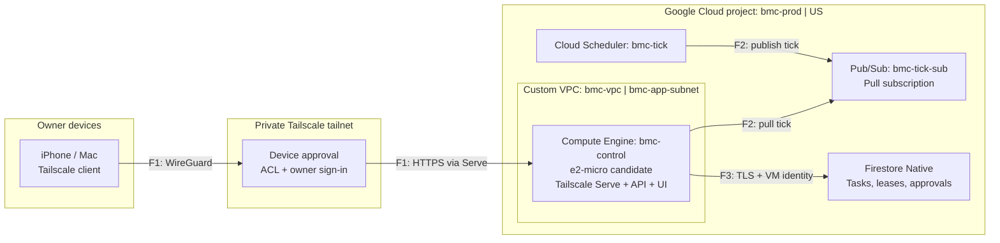
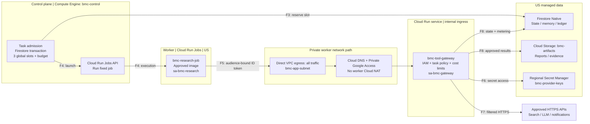
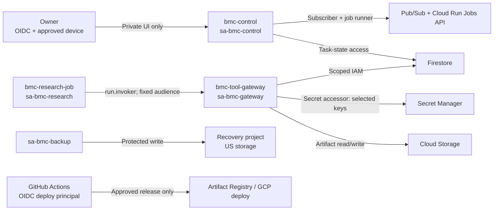
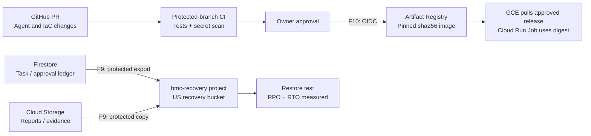

# Hosting and networking: Remote-first architecture

> [!IMPORTANT]
> **Proposal only. Nothing is deployed.** Google Cloud and `us-central1` are reference choices, not approved purchases or final selections. This design follows the [project constitution](../../CONSTITUTION.md). Text follows ASD-STE100 principles; it is not formally STE-certified.

| Design target | Requirement |
| --- | --- |
| Access | iPhone and Mac worldwide; trusted devices; Mac may be off; private chat, dashboard, and approvals |
| Compute | One Research Agent first; 2–3 jobs at once; 15–60 s cold start; stop workers when idle |
| Control | GitHub-approved definitions; risk-based actions; 24 h expiring approvals; emergency stop |
| Data | US-region operational storage; private agent memory; approved model providers; owned results |
| Recovery | Critical RPO ≤1 h; other RPO ≤24 h; service RTO ≤24 h; measured, not assumed |
| Budget | $10–$30/month infrastructure target; LLM and search API spend separate; no automatic spend increases |
| Portability | Provider-neutral agent interfaces; cloud-specific infrastructure is acceptable if it saves cost |

## 1. Network and remote access



| Boundary | Required control |
| --- | --- |
| Device → tailnet | Enroll devices; use Tailscale ACLs and separate owner OIDC session; revoke lost devices; keep recovery device and credentials |
| Internet → control VM | **Deny inbound** SSH, HTTP, HTTPS, and app ports in GCP firewall; do not expose dashboard via public IP or load balancer |
| Control VM → VPC | No general tailnet subnet router; do not expose the rest of the VPC to devices |
| Control VM → Tailscale | Outbound tunnel; neutral DNS name; HTTPS certificate name can appear in public Certificate Transparency logs |
| Cloud Scheduler → VM | Pub/Sub **pull** only; no push endpoint into a private VM; reconcile missed ticks after restart |
| Deployment boundary | No Kubernetes, public SSH, public load balancer, Cloud NAT for workers, or VPC Service Controls (VPC-SC) in v1 |

**Availability:** One GCE zone. A VM failure can stop the dashboard. Active cloud jobs may continue. Rebuild from code and protected data within the 24 h RTO target. Some travel networks can block VPN connections.

## 2. Work execution and data paths



| Flow | Caller → service | Identity / contract |
| --- | --- | --- |
| F1 | Approved device → `bmc-control` | WireGuard + Tailscale Serve HTTPS; owner OIDC login |
| F2 | Cloud Scheduler → Pub/Sub → control VM | Scheduler publish; VM pull with subscriber role; at-least-once |
| F3 | Control VM → Firestore | VM identity; atomic queue order, lease, slots, budget; task idempotency key |
| F4 | Control VM → Cloud Run Jobs API | `run.jobs.runWithOverrides` on **fixed** `bmc-research-job`; validate task ID |
| F5 | Research Job → internal tool gateway | Direct VPC egress; private DNS/PGA; audience-bound Google ID token; request bound to task |
| F6 | Gateway → Secret Manager | Gateway identity; secret-level `secretAccessor`; never return keys to workers |
| F7 | Gateway → approved providers | Validated public destination; approved tools/models; budget reservation; redacted logs |
| F8 | Gateway → Firestore / Cloud Storage | Task-specific permission checks; durable status, citations, reports, metering |
| F9 | Backup identity → separate recovery project | Protected US copies; no production-worker delete rights |
| F10 | Approved GitHub release → GCP | OIDC federation after approval; pinned images and IaC, no inbound VM SSH |

**Worker network rule:** Workers cannot call public APIs, internal subnets, or secrets directly. Route all worker traffic into the VPC; omit worker Cloud NAT. Allow only the private gateway path. Test DNS for `run.app`, Google API VIPs, internal ingress, and firewall rules before deployment. A Cloud Run Job can still reach its **metadata server** for its own short-lived identity token. Firewall rules do not remove that endpoint.

**Gateway rule:** Authenticate the workload and verify its `agent_id`, `task_id`, approved tool, destination, budget, and action. Deny private, loopback, link-local, and metadata IPs. Validate DNS results and redirects to prevent SSRF. Treat web pages and model output as untrusted data. Never let an agent approve its own action.

**Execution rule:** `parallelism: 1` limits tasks *within* one Cloud Run Job execution. It does **not** limit concurrent executions. Track actual execution IDs; reserve at most three global slots by Firestore transaction. Reconcile expired leases against running executions. Never allocate a fourth slot while three executions are active.

## 3. Task handoff and approvals

```mermaid
sequenceDiagram
    autonumber
    actor User as Owner (iPhone / Mac)
    participant VM as bmc-control (GCE)
    participant DB as Firestore
    participant RUN as Cloud Run Jobs API
    participant JOB as Research Job
    participant GW as Tool Gateway
    participant OBJ as Cloud Storage
    User->>VM: F1 Submit task + idempotency key
    VM->>DB: F3 Save queued task
    VM->>DB: F3 Reserve global slot + cost budget (transaction)
    VM->>RUN: F4 Start fixed job with task ID
    RUN-->>JOB: Launch execution
    JOB->>GW: F5 Request approved research tool
    GW->>DB: F8 Check authority + budget; record use
    GW-->>JOB: Return sanitized result
    JOB->>GW: Submit citations + final report
    GW->>GW: Validate sources, citations, quality
    GW->>OBJ: F8 Store accepted artifact
    GW->>DB: F8 Commit result and release slot
    VM-->>User: Dashboard shows result and report link
    opt Sensitive external action
        JOB->>GW: Propose exact action
        GW->>DB: Save approval, 24 h expiry
        Note over VM,DB: Worker releases capacity; control scans approvals
        VM->>DB: Read pending approval
        VM-->>User: Show approval request in private dashboard
        User->>VM: Approve or reject action
        VM->>DB: Check expiry + exact payload; requeue if approved
        Note over VM,DB: No response means DENY
    end
```

| State / rule | Required behavior |
| --- | --- |
| Task states | `queued → reserved → running → validating → completed`; also `checkpointed`, `awaiting_approval`, `denied`, `canceled`, `failed`, `quarantined` |
| Priority | Urgent work precedes scheduled work in the queue; prevent starvation; do not interrupt running work automatically |
| Capacity | 2–3 concurrent tasks including delegated workers; pause or approval releases compute; bounded retries |\n| Job timeout | Start with a 60-minute Cloud Run Job task timeout (default is 10 minutes); checkpoint long work |
| Restart | Pull Pub/Sub again; reconcile executions, leases, budgets, and missed schedules; bounded catch-up; no exactly-once claim for external APIs |
| Quality | Check source reachability, citation evidence, duplicate findings, completeness, and budget before marking success |\n| Notifications | Notify on completion, failures, approvals, security, and budget events; support summaries and private lock-screen content |
| Emergency controls | Pause, resume, cancel, retry, quarantine, per-agent stop, and global stop; stop new tool calls at gateway |
| Approval | Exact-action, owner-only, 24 h default expiry; expiry is denial; persist state for later retry |
| Autonomy | Dynamic plans inside fixed policy; code, permanent agent identities, deployments, and permissions require owner-approved PRs |\n| Models | Route to approved providers by cost, quality, privacy, and availability; log cost per successful task |

**v1 isolation limit:** Cloud Run Jobs runs **reviewed Research Agent code only**. It is not approved as a general sandbox for arbitrary agent-generated code. A future Engineering Agent needs a separate isolation and egress review.

## 4. Trust boundaries, identities, and APIs



| Principal | Allowed | Denied / limited |
| --- | --- | --- |
| Owner | Private dashboard; authorized approvals | No browser-held cloud service credentials |
| `sa-bmc-control` | Pub/Sub subscriber; fixed Job executor with overrides; task database and report-read rights | No LLM keys, project admin, or recovery delete rights |
| `sa-bmc-research` | `roles/run.invoker` **only** on gateway; fixed task authority | No Firestore, Cloud Storage, Secret Manager, general cloud admin, or public egress |
| `sa-bmc-gateway` | Specific secrets, Firestore state, artifact objects; server-side per-agent authorization | No `roles/editor` or owner role; no tool action without policy |
| Scheduler service agent | Publish to `bmc-tick-topic` | No job execution or task-data read |
| Backup identity | Export/write to protected recovery bucket | No delete of protected history; separate admin boundary |
| GitHub OIDC principal (future) | Approved image publishing and IaC deployment | No long-lived cloud keys, PR secrets, or unrestricted runtime impersonation |

**Memory policy:** Private per-agent memory by default. The gateway authorizes each cross-agent share. Record source evidence and support review, correction, and deletion.\n\n**Firestore warning:** Server SDKs bypass Firestore Security Rules. IAM does not enforce record-level agent ownership. The gateway must check `owner`, `agent_id`, `task_id`, and action on each data operation. Workers have no direct Firestore access.

**GCP APIs to enable only after approval:**

| Group | APIs / product purpose |
| --- | --- |
| Network and compute | `compute.googleapis.com`, `dns.googleapis.com`, `run.googleapis.com`, `artifactregistry.googleapis.com` |
| State and events | `firestore.googleapis.com`, `storage.googleapis.com`, `cloudscheduler.googleapis.com`, `pubsub.googleapis.com` |
| Keys and monitoring | `secretmanager.googleapis.com`, `logging.googleapis.com`, `monitoring.googleapis.com` |
| Provisioning and identity | `cloudresourcemanager.googleapis.com`, `serviceusage.googleapis.com`, `iam.googleapis.com`, `iamcredentials.googleapis.com`, `sts.googleapis.com` |
| Budget notifications | `billingbudgets.googleapis.com` where available; **alerts are not spend caps** |

**Not enabled in v1:** VPC Service Controls, external API Gateway, Cloud NAT for workers, GKE, Cloud SQL, load balancer, serverless VPC connector. VPC-SC is an organization-level control, not a replacement for IAM and firewalls.

## 5. Release, storage, and recovery



| Class | Location / retention | Recovery target |
| --- | --- | --- |
| Task, approval, budget, memory | Firestore Native, US region; 12 months for task/audit; approved memory longer | Critical RPO ≤1 h |
| Reports and evidence | Private Cloud Storage `bmc-artifacts`, US region; downloadable/exportable, with approved delivery copies | Reproducible RPO ≤24 h |
| Diagnostic traces | US regional Cloud Logging bucket; 30 days; redact secrets/payloads | Not critical |
| Recovery copies | US bucket in separate `bmc-recovery` project; protected retention and distinct admin access | Whole service RTO ≤24 h |

**Backup gate:** Firestore PITR and native backups cost money. PITR alone does not protect against project loss. Test hourly protected export **or** a shorter event journal. Prove the ≤1 h RPO with a restore test. The backup writer cannot delete retained copies.

**Restore order:** Stop dispatch → recover private access → restore task/approval/budget ledger → restore artifacts → reconcile running jobs and external side effects → check audit data → resume dispatch.

**Location limit:** Keep user content and selected regional services in US regions. Verify Google Cloud control-plane metadata, default/required logs, Tailscale coordination, and external LLM processing separately. Do not claim strict US-only processing without this review.

## 6. Provider and budget decision

**Common test:** One owner; 50 monthly jobs; 15 total worker-hours; 1 vCPU and 1 GiB per job; no GPU. API inference and paid search are outside the $10–$30 infrastructure target.

| Provider pattern | Benefits | Cost or security condition | Status |
| --- | --- | --- | --- |
| **GCP:** GCE + Tailscale + Cloud Run Jobs + Firestore | Private device access; scale-to-zero workers; managed state | Measure 1 GiB VM capacity, IP, DNS, regional backups and private egress | **Reference** |
| **AWS:** EC2 + Tailscale + ECS Fargate + SQS/DynamoDB | Similar compute and isolation patterns | NAT / VPC endpoints, data backup and fixed costs may exceed budget | Evaluate |
| **DigitalOcean:** Droplet + Tailscale + ephemeral workers | Simple entry VM and pricing | More self-managed queue, credentials, data and recovery | Evaluate |
| **GCP:** Cloud Run + IAP, no VM | Low idle compute | IAP login alone does **not** prove trusted-device restriction | Conditional |

| GCP planning item | Reference assumption; verify before spend |
| --- | --- |
| `e2-micro` + 30 GiB standard disk | Eligible GCP free-tier allowance in certain US regions, **only if unused and applicable** |
| External VM IPv4 | About $0.005/hour; about **$3.65 per 730-hour month** |
| Cloud Run Jobs | About 15 vCPU-hours plus memory usage; verify region rates and free-tier use |
| Scheduler / Pub/Sub / Firestore | Usage-based; Firestore PITR, backup and some storage operations are **paid** |
| DNS / Cloud Storage / Secret Manager / Logging / Artifact Registry | Price network, data volume, retained objects, images, requests and secrets |
| Alerts | Set project budget alerts **and** independent task/provider spending limits; no automatic billing hard stop |

**Selection gate:** Compare complete monthly prices, not just VM or worker price. Include secure network paths, minimum storage, backups, logs, region, real mobile access, and restored-system testing. If security and recovery exceed $30/month, request new budget approval or revise the design. Do not silently weaken controls.

## 7. Release gates and planned scope

| Gate before any live deployment | Proof required |
| --- | --- |
| Remote access | iPhone on cellular can chat, approve, read report, revoke device; Mac offline; public port scan finds no open dashboard/SSH |
| Worker isolation | Worker cannot reach public URLs, internal subnets, Firestore, secrets, or artifact storage; gateway accepts only intended ID token |
| Private gateway | Direct VPC egress + private DNS + internal Cloud Run ingress work under real networking; metadata token grants no extra services |
| Untrusted content | Gateway blocks private DNS/IPs, redirects, metadata IPs, SSRF, unapproved tools and prompt-based authority escalation |
| Concurrency | Duplicate ticks, failed launches and expired leases never exceed three live executions |
| Data correctness | Sources, citations, dedupe, quality, step limits, and idempotent recovery pass tests |
| Recovery | Restore critical data within ≤1 h RPO and service within ≤24 h RTO; recover after project or VM loss |
| Security / cost | Regional data/logs and backup boundaries verified; 30-day workload costs fit approved envelope |

| First release | Later, only with separate review |
| --- | --- |
| One AI/data engineering Research Agent; manual + scheduled tasks; private mobile chat/dashboard; results, approvals, quality checks, alerts, structured traces and cost tracking | Public webhook ingress, home-Mac access, invited users, new permanent agents, temporary subworkers, arbitrary-code sandboxes, native iOS app, hosted model inference, VPC-SC |

## Reference sources

[GitHub Mermaid diagrams](https://docs.github.com/en/get-started/writing-on-github/working-with-advanced-formatting/creating-diagrams) · [GCP free tier](https://cloud.google.com/free/docs/free-cloud-features) · [Cloud Run Jobs](https://cloud.google.com/run/docs/create-jobs) · [Cloud Run ingress](https://cloud.google.com/run/docs/securing/ingress) · [Cloud Run Direct VPC egress](https://cloud.google.com/run/docs/configuring/vpc-direct-vpc) · [Firestore permissions](https://cloud.google.com/firestore/native/docs/security/insecure-rules) · [Firestore pricing](https://cloud.google.com/firestore/pricing) · [Tailscale device approval](https://tailscale.com/docs/features/access-control/device-management/device-approval) · [Tailscale Serve](https://tailscale.com/docs/features/tailscale-serve).
